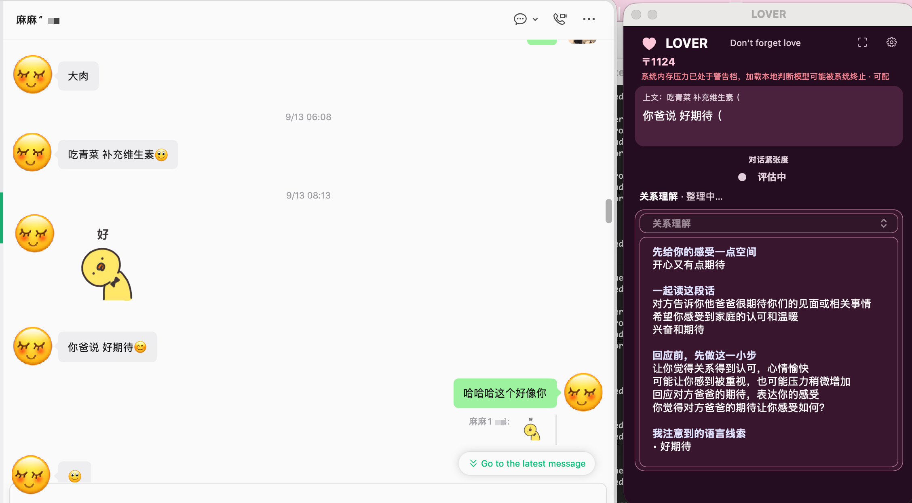
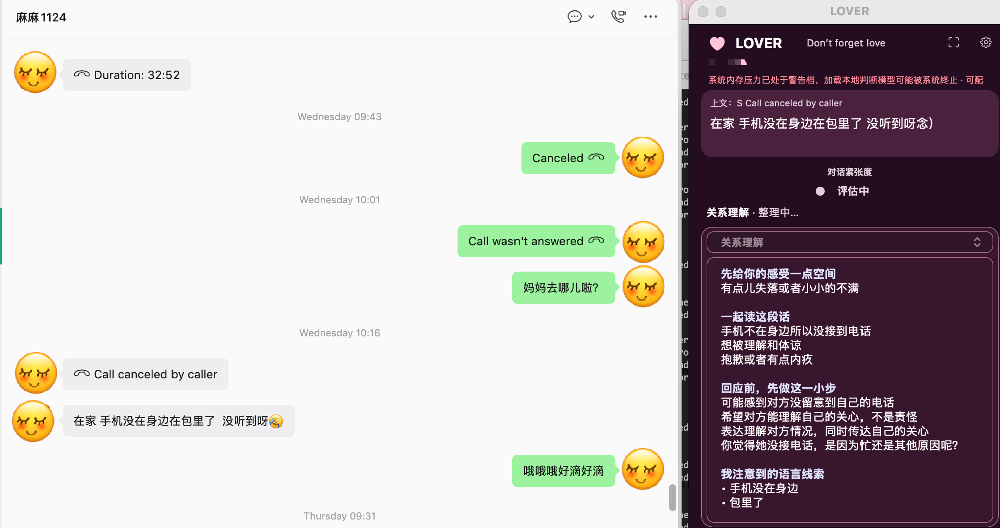

# LOVER

> Don’t forget love.

LOVER is a Chinese-first macOS companion for taking a breath before responding in an intimate conversation.

## Why I built LOVER

The people closest to us can also be the easiest people to hurt. I learned that lesson in my own relationship.

There were moments when I mistook my fear for certainty. A short sentence sounded like blame; a delayed reply felt like rejection. I answered from the first wave of emotion instead of trying to understand what the other person was really asking for. I said things too quickly, and I did things that created distance where I wanted closeness.

I still regret many of those moments. I cannot rewrite them, but I do not want that regret to become only self-punishment. I want it to become a reason to pause: to look past my first interpretation, make room for my own reaction, and ask what may be happening underneath the words before I respond.

Often, neither person wants to hurt the other. They may simply be asking, in different ways, to be heard, reassured, respected, or given space. I built LOVER to offer that small pause when it matters most.

LOVER does not decide who is right or claim to know someone’s inner world. It offers possibilities: a prompt to slow down, hold more than one interpretation, and choose a response that is clearer, kinder, and still honest.

The hope is simple: fewer conversations that end in regret, and a little more room for love.

## What it does

- Watches the supported chat window currently visible on your Mac.
- Shows a real-time conversation-tension rating: **low**, **medium**, or **high**.
- Creates one relationship-understanding card for the latest message.
- Surfaces possible feelings, needs, and unspoken requests beneath the words.
- Highlights language cues that may affect how the message is heard.
- Makes room for your own response without asking you to lose your boundaries.
- Never sends messages automatically.

## In the app

LOVER appears as a floating window beside the conversation you are already having. It keeps the message and its immediate context visible, then offers a compact tension reading and a relationship-understanding card: space for your reaction, a possible reading of the other person’s words, what they may be trying to be heard about, and the language cues behind that reading.



*A warm conversation can still benefit from being read with care: LOVER keeps the original message and its possible emotional meaning side by side.*



*LOVER is designed to make room for context before a response—without sending, rewriting, or speaking for you.*

## Chinese-first, language-aware

I am Chinese, and I believe emotional language is often closest and most nuanced in one’s mother tongue. The words we use for care, disappointment, longing, anger, and repair carry cultural and personal meaning that can become flatter in translation.

For that reason, the LOVER interface is currently in Chinese. Its relationship reflection follows the language of the incoming message, so a Chinese message receives a Chinese response and messages in other languages are reflected in their original language.

## What LOVER is not

LOVER is not therapy, diagnosis, relationship counselling, or a tool for determining another person’s “true intentions” with certainty.

It works with possibilities, not verdicts. Use it as a moment to pause and reflect—not as a replacement for direct communication, consent, trust, professional support, or your own judgment.

## Privacy and safety

- LOVER analyzes only conversation content visible on your screen while a supported chat app is in the foreground.
- It does not inject into chat apps, decrypt chat databases, or send messages on your behalf.
- You configure your own model provider and API key in `~/.config/lover/env`; no API key is included in this repository.
- Local conversation history is optional. If enabled, it stays on your Mac at `~/Library/Application Support/lover/conversations.json`.
- Any API-backed analysis is sent to the model provider that **you** configure. Review that provider’s privacy policy before using it with sensitive conversations.

Please use LOVER only with conversations you are authorized to view, and in accordance with applicable law and the terms of the chat app you use.

See [PRIVACY.md](PRIVACY.md) for the detailed data flow.

## Requirements

- Apple Silicon Mac (M-series)
- macOS 13 or later
- A supported chat app
- Screen Recording permission for screenshot-based reading
- An API key for an OpenAI-compatible or Anthropic-compatible generation provider

## Run from source

```bash
git clone https://github.com/<your-github-username>/lover.git
cd lover
./start.command
```

On first launch, grant **Screen Recording** permission when macOS asks. LOVER may also ask for **Accessibility** permission if you use its optional fill-in feature; it will never press Send.

### Configure your own API key

Create `~/.config/lover/env`:

```bash
mkdir -p ~/.config/lover
cat > ~/.config/lover/env <<'ENV'
export OPENAI_API_KEY="your-api-key"
export OPENAI_BASE_URL="https://api.openai.com/v1"
export OPENAI_MODEL="your-model-name"
ENV
chmod 600 ~/.config/lover/env
```

You can also configure compatible Anthropic endpoints or local models. See [`.env.example`](.env.example) for available settings. Do not commit this file or any API key.

## Project status

LOVER is an experimental personal project. It currently focuses on intimate-relationship communication and Chinese-first interaction design. Its interpretations can be wrong, especially without enough context—please treat them as invitations to reflect, not facts.

Thoughtful feedback, bug reports, and contributions are welcome.

## Origin and acknowledgements

LOVER is adapted from [jev-chat/jev-chat-jarvis](https://github.com/jev-chat/jev-chat-jarvis). It has been reshaped into a relationship-focused macOS reflection tool.

Please see [NOTICE](NOTICE) for required attribution notices.

## License

MIT. See [LICENSE](LICENSE) and [NOTICE](NOTICE).
